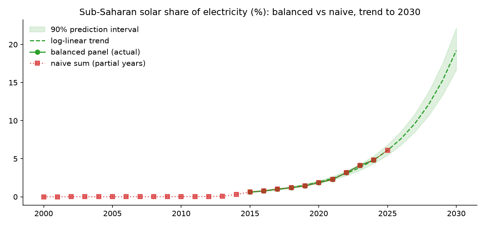
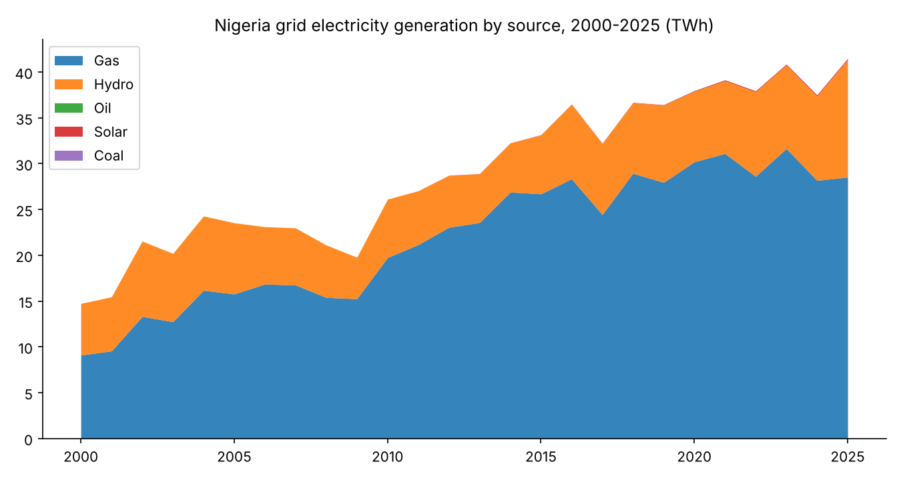

# Africa Electricity Data Audit

**Live dashboard:** https://shieldemma.github.io/africa-electricity-data-audit/

An automated, tested pipeline that audits national electricity statistics for 30 sub-Saharan African countries (2000–2025). It joins Our World in Data electricity data (built on Ember and Energy Institute data) with World Bank WDI, runs its quality checks in both Python and SQL, and publishes an interactive dashboard that GitHub Actions refreshes every month.

## What it shows

| Skill | Where it lives |
|---|---|
| Multi-source ingestion: OWID bulk CSV + World Bank WDI REST API (Ember's bulk file is also tried each run and skipped if unavailable) | `pipeline/fetch.py` |
| Data validation: 6 automated checks plus cross-source reconciliation | `pipeline/checks.py`, `pipeline/crosscheck.py` |
| SQL (DuckDB): the same checks written in SQL, with the pipeline asserting both versions agree | `sql/checks.sql`, `run_pipeline.py` |
| Statistical modelling: log-linear OLS trend with a 90% prediction interval, out to 2030 | `pipeline/forecast.py` |
| Interactive visualisation: Plotly dashboard served on GitHub Pages | `pipeline/dashboard.py` → `docs/index.html` |
| Testing and CI/CD: pytest unit tests; GitHub Actions runs tests, refreshes the data monthly, and commits outputs | `tests/`, `.github/workflows/pipeline.yml` |
| Communication: plain-English findings for non-specialists | this README, dashboard notes |

Run it locally: `pip install -r requirements.txt && python -m pytest -q tests && python run_pipeline.py`. The Ember and World Bank downloads are optional; if a source can't be reached, the checks that depend on it are skipped and logged.

## Checks

| Check | What it catches |
|---|---|
| Net imports exactly 0 in some years, non-zero in others | Missing values stored as 0, which silently sets demand equal to generation |
| Net imports identical to the year before | Values carried forward instead of updated |
| Demand >15% below generation | Real exporters, or output from shared assets assigned to one country |
| Year-on-year change in generation >40% (systems >1 TWh) | Breaks in a series, new plants, or reporting changes |
| Sources don't sum to the total, and gaps between years | Internal consistency |
| OWID vs Ember (when Ember's file is available): generation differs by >2%; OWID shows 0 imports where Ember shows trade | Disagreement between sources or vintages |
| OWID vs World Bank population differs by >3% | Population denominators behind the per-capita metrics |

Flag tables: `outputs/quality_issues_*.csv`. Headline numbers: `outputs/key_facts.json`.

## Findings so far

**1. Zero-vs-missing trade data (Nigeria).** In OWID, Nigeria's net imports are small exports in 2000–2004, then **exactly 0 for 2005–2015**, then −2 to −3 TWh a year from 2016. Nigeria exported power to Niger, Benin and Togo throughout that period, so the zeros look like missing data. They inflate implied demand by about 2 TWh (6–7%) in those years. When Ember's bulk file is available, the pipeline also compares it against Ember's own net-import series. The 2025 value also exactly repeats 2024's.

**2. Partial latest years bias regional totals.** Only 4 of the 30 countries have 2025 data in this release. A naive sum gives a 6.1% sub-Saharan solar share. A balanced panel of the 30 countries reporting every year from 2015 to 2024 gives **0.6% → 4.8%**. The log-linear trend is about 26% a year, which projects to roughly 19% by 2030 (90% interval about 17–22%). That is a statistical extrapolation, not a policy forecast.

**3. Shared assets show up as "demand below generation".** Mali shows demand 16–37% below generation in 10 of the 11 years from 2002 to 2012. A plausible cause, which still needs verifying, is the Manantali dam: it sits in Mali, and its output is shared with Senegal and Mauritania.

**4. Access-adjusted output (World Bank join).** Population denominators in OWID and the World Bank agree within 3% for every country-year in the sample. Using World Bank access rates, Nigeria's 2024 grid output works out to about **258 kWh per person with electricity access** (62.5% access). That compares with 4,287 in South Africa, 767 in Ghana and 305 in Kenya. See `outputs/ssa_access_and_generation_per_connected_person.csv`.

**5. Nigeria's grid.** 41.5 TWh in 2025: 68.7% gas, 30.9% hydro. That is about 175 kWh per person, among the lowest in the sample. Grid statistics also leave out Nigeria's large diesel/petrol self-generation.

## Next steps

Cross-check flagged country-years against national and power-pool reports (TCN/NERC, WAPP). Replace false zeros with flagged nulls, and publish the imputation log. Add monthly Ember data.

Author: Otuekong "Shield" Udo · [github.com/Shieldemma](https://github.com/Shieldemma)
