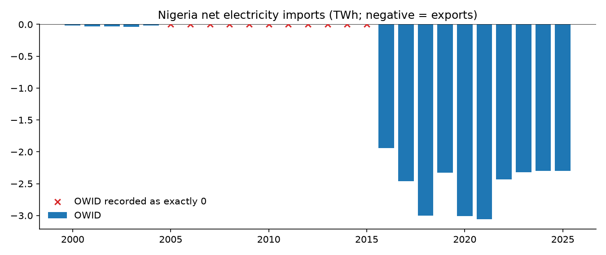
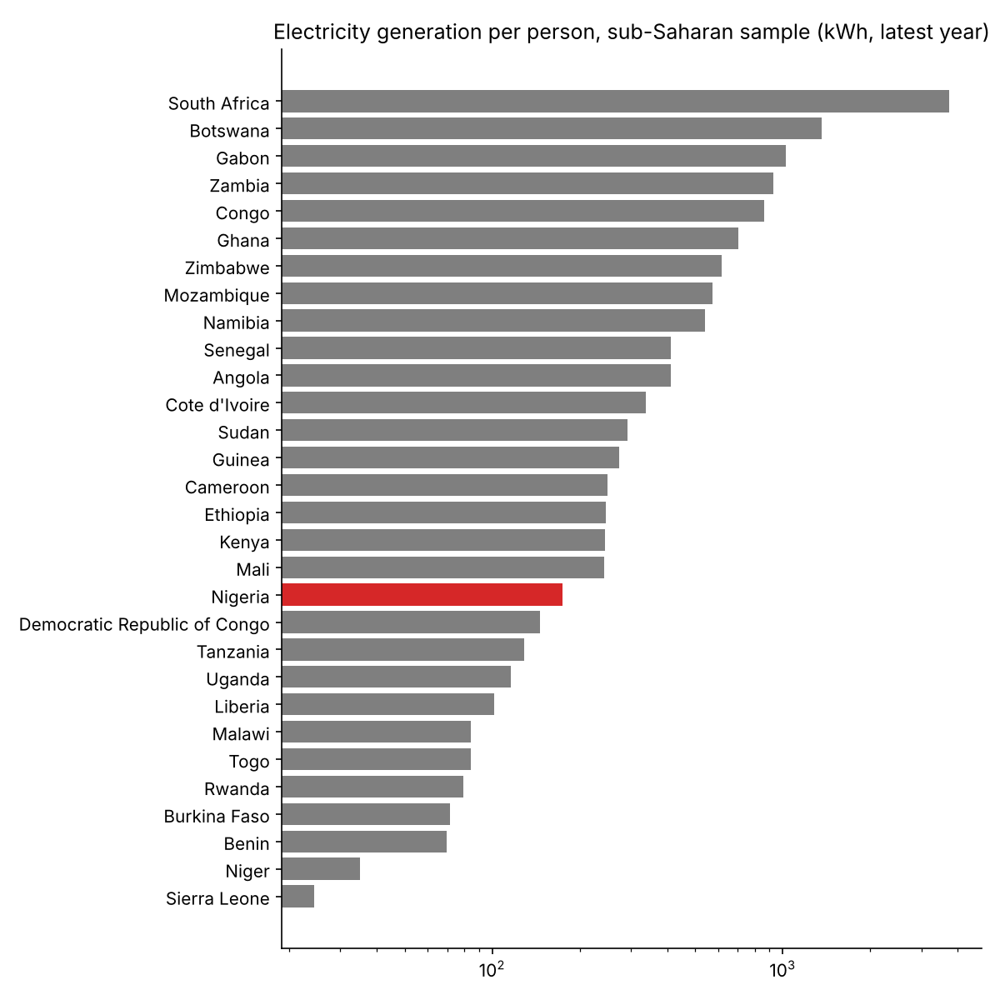

# Africa Electricity Data Audit

A reproducible quality audit of national electricity statistics for 30 sub-Saharan African countries (2000–2025), plus a short analysis of Nigeria's power mix.

**Data:** [Our World in Data energy dataset](https://github.com/owid/energy-data). Its electricity series are built mainly on Ember and Energy Institute data.
**Run it:** `pip install -r requirements.txt && python analyze.py`. The script downloads the CSV if it isn't already there, and writes everything to `outputs/`.

## What the audit checks

| Check | What it catches | Flags (all countries / SSA sample) |
|---|---|---|
| Net imports exactly 0 in some years, non-zero in others | Missing values stored as 0, which silently sets demand = generation | 38 / 11 |
| Net imports identical to the year before | Values carried forward instead of updated | 113 / 49 |
| Demand >15% below generation | Real exporters, or generation from shared assets assigned to one country | 203 / 49 |
| Year-on-year change in generation >40% (systems >1 TWh) | Breaks in series, new plants, or reporting changes worth checking | 39 / 9 |
| Sources don't sum to the total; total with no fuel breakdown; gaps between years | Internal consistency | 0 in this release |

The full flag lists are in `outputs/quality_issues_all_countries.csv` and `outputs/quality_issues_sub_saharan_africa.csv`.

## Findings

**1. Nigeria's trade data shows a zero-vs-missing problem.** Net imports are small negative numbers (exports) in 2000–2004, then **exactly 0 for 2005–2015**, then about −2 to −3 TWh every year from 2016. Nigeria exported power to Niger, Benin and Togo throughout that period, so the zeros are almost certainly missing data, not "no trade". Anyone computing Nigerian demand from this series overstates it by about 2 TWh (~6–7%) for those years. The 2025 value (−2.30 TWh) also exactly repeats 2024's, which suggests a carried-forward estimate.

**2. Partial latest years distort aggregates.** In this release, only 4 of the 30 sample countries have 2025 generation data. A naive sum gives a sub-Saharan solar share of 6.1% in 2025. Restricting to the 30 countries that report every year from 2015 to 2024 gives **0.6% (2015) → 4.8% (2024)**. The script builds that balanced panel automatically and saves the year-by-year coverage to `outputs/ssa_reporting_coverage_by_year.csv`.

**3. Shared assets show up as "demand below generation".** Mali shows demand 16–37% below generation in 10 of the 11 years from 2002 to 2012, even though it is not a big net exporter. A plausible cause, which still needs verifying, is Manantali: a dam in Mali whose output is shared with Senegal and Mauritania. Côte d'Ivoire, Mozambique and Zambia also trip this check, but they are known exporters, so their flags are expected.

**4. Nigeria's grid is gas-heavy, and its grid output per person is tiny.** In 2025, grid generation was 41.5 TWh: 68.7% gas, 30.9% hydro and 0.3% solar. That works out to about 175 kWh per person, among the lowest in the sample. Grid statistics also leave out Nigeria's very large diesel/petrol self-generation, so this series understates actual consumption.

## Next steps

- Cross-check flagged country-years against national utility, regulator and power-pool reports (e.g. NERC/TCN for Nigeria, WAPP).
- Replace zeros with nulls where trade is known to exist, and document the imputation.
- Add monthly data and API ingestion so the checks run on every new release.

Author: Otuekong "Shield" Udo · [github.com/Shieldemma](https://github.com/Shieldemma)
